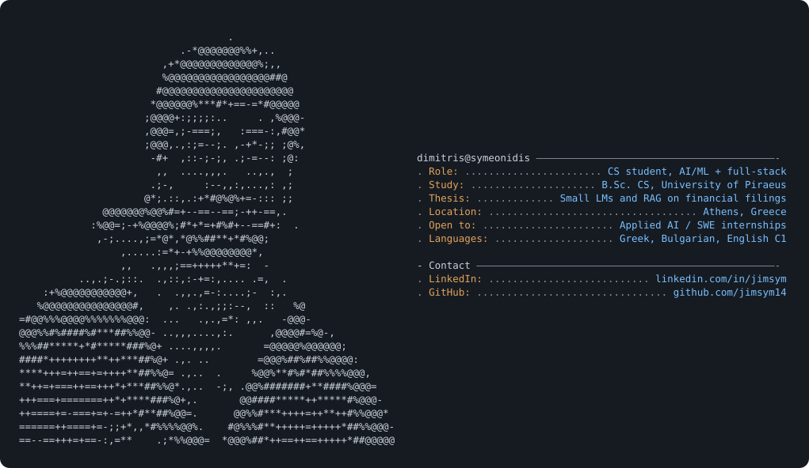

## Projects

**[RAGscope](https://github.com/jimsym14/RAGscope)** — B.Sc. thesis
Compares 5 small language models (3B–9B) and 4 RAG pipelines on Apple 10-K filings.
All inference runs locally with Ollama.
Answer quality is measured with Ragas, 2 LLM judges and an adversarial refusal test.
`Python` `Ollama` `ChromaDB` `Ragas` `Streamlit`

**[Jigsaw solver](https://github.com/jimsym14/jigsaw-puzzle-solver-2026)** — computer vision
Rebuilds images from shuffled and rotated tiles.
Correct placement and rotation on 6 of 7 test images.
`Python` `OpenCV` `PyTorch`

**[Lab Teams Portal](https://github.com/jimsym14/lab-teams-assignment-yplo)** — REST API with 30+ RSpec tests and OpenAPI docs. `Ruby on Rails`

**[UnipiCityVibe](https://github.com/jimsym14/UnipiCityVibe)** — Android event app with GPS proximity alerts. `Java` `Firebase`

**[WordMates](https://github.com/jimsym14/WordMates)** — Real-time multiplayer word game. `Next.js` `TypeScript` `Firebase`

## Skills

- **Languages:** Python, Java, TypeScript, JavaScript, SQL, Swift
- **AI/ML:** PyTorch, scikit-learn, RAG, Ollama, ChromaDB, Ragas
- **Web and mobile:** React, Next.js, Node.js, SwiftUI, Android, Firebase, Ruby on Rails
- **Tools:** Git, Docker, Linux, PostgreSQL, AWS
